# GapFinder AI — Adaptive Knowledge Gap & Revision Platform

[](https://nextjs.org/)
[](https://www.typescriptlang.org/)
[](https://tailwindcss.com/)
[](https://vitest.dev/)
[](https://github.com/pacocoursey/next-themes)
[](https://vercel.com/)

**GapFinder AI** is an intelligent, full-stack learning platform designed to diagnose student knowledge gaps from uploaded syllabi, textbook chapters, lecture notes, and past question papers. It generates RAG-grounded diagnostic assessments, mathematically calculates topic mastery, explains misconceptions with source citations, and creates a personalized, spaced-repetition revision plan.

---

## Table of Contents
1. [Core Features](#core-features)
2. [Authentication & Theme System](#authentication--theme-system)
3. [Architecture Diagram](#architecture-diagram)
4. [RAG Pipeline Explanation](#rag-pipeline-explanation)
5. [Mastery Classification & Deterministic Scheduler Algorithms](#mastery-classification--deterministic-scheduler-algorithms)
6. [Demo Dataset (Computer Networks)](#demo-dataset-computer-networks)
7. [Quick Start & Installation](#quick-start--installation)
8. [GitHub & Vercel Deployment Instructions](#github--vercel-deployment-instructions)
9. [Supabase & Gemini Integration Setup](#supabase--gemini-integration-setup)
10. [Automated Test Suite](#automated-test-suite)
11. [Limitations & Future Enhancements Roadmap](#limitations--future-enhancements-roadmap)

---

## Core Features

- **Dashboard**: Real-time subject statistics, overall exam readiness score (0–100%), topic mastery distribution, recent quiz history, and high-priority gap alerts.
- **Study Materials Ingestion**: Upload PDF documents (`.pdf`), plain text (`.txt`), and markdown notes (`.md`). Automatically extracts text, preserving document names, page numbers, and section headers.
- **Syllabus Topic Map**: Deconstructs syllabi into structured units, subtopics, exam weightages (High / Medium / Low), and target mastery scores.
- **RAG-Grounded Quiz Generator**: Questions (both Multiple Choice and Short Answer) are dynamically generated **strictly from retrieved uploaded materials**. Every question stores source chunk references.
- **Interactive Source Citations**: Clickable source citation pills (`[Document Name, Page X, Section Y]`) that open a preview modal of the exact source passage.
- **Real Calculations & Answer Evaluation**:
  - Deterministic and AI-driven evaluation for short answers and MCQs with partial credit (0–100%).
  - Detailed mistake explanations and concrete knowledge gap identification.
- **Strict Topic Mastery Classifications**:
  - **Weak**: $< 60\%$
  - **Medium**: $60\% - 79\%$
  - **Strong**: $\ge 80\%$
- **Deterministic Spaced-Repetition Revision Planner**:
  - Input exam target date and daily study hours.
  - Dynamically allocates study time (50% Weak, 35% Medium, 15% Strong maintenance).
  - Day-by-day interactive tasks (Deep Dive Concept Review, Active Recall, Past Paper Drill, Retest Quiz) with persistent task-completion tracking.
- **Grounded AI Study Assistant**: Conversational tutor grounded strictly in uploaded materials with inline citations.
- **Zero-Config Demo Mode**: Works instantly out of the box with bundled Computer Networks materials and local persistence without requiring external API keys. Automatically upgrades to live Gemini 1.5 Flash and Supabase PostgreSQL when credentials are supplied.

---

## Authentication & Theme System

### 1. Authentication UI (`/login` & `/register`)
- **Responsive Auth Pages**: Clean, modern education SaaS aesthetics with educational vector illustrations, show/hide password toggles, and form field validation.
- **Dual Mode Operation**:
  - **Supabase Auth Integration**: When Supabase credentials are configured in `.env.local`, uses secure Supabase email/password sessions, registration, and logout.
  - **Evaluator Demo Session Mode**: When Supabase credentials are not configured, displays an informative setup guide with an instant **"Explore with Demo Session"** action so reviewers can test every protected feature immediately without roadblocks.
- **Session Management**: Persistent auth context via `AuthContext.tsx` with sign-out support in the top header.

### 2. Dark Mode and Light Mode (`next-themes`)
- **Theme Modes**: Supports **Light**, **Dark**, and **System** preference with a persistent theme toggle in the dashboard header, sidebar, and login page.
- **No Hydration Mismatches**: Safe client-side mounting checks with `suppressHydrationWarning` on `<html>`.
- **Semantic Palette**:
  - **Light Theme**: Crisp whites (`#FFFFFF`), neutral slates (`#F8FAFC`), deep charcoal headings (`#0F172A`), and vibrant indigo accents (`#4F46E5`).
  - **Dark Theme**: Rich dark slates (`#0B0F19`), card surfaces (`#111827`, `#1E293B`), light-gray text (`#F9FAFB`), high-contrast borders (`#334155`), and luminous indigo accents.
- All cards, charts, badges, modals, quizzes, and code blocks adapt cleanly across both themes.

---

## Architecture Diagram

```mermaid
flowchart TD
    subgraph Client ["Client (Next.js 14 App Router + React + Tailwind + next-themes)"]
        UI_Auth["Auth (/login, /register)"]
        UI_Dash["Dashboard (/)"]
        UI_Materials["Materials & Corpus (/materials)"]
        UI_TopicMap["Topic Map (/topic-map)"]
        UI_Quiz["Diagnostic Quiz (/quiz)"]
        UI_Gap["Gap Analysis Report (/gap-report)"]
        UI_Plan["Revision Planner (/revision-plan)"]
        UI_Tutor["AI Assistant (/assistant)"]
    end

    subgraph API ["Next.js Server API Route Handlers"]
        API_Doc["/api/documents (Upload & Extract)"]
        API_Topics["/api/topics (Syllabus Hierarchy)"]
        API_QuizGen["/api/quiz/generate (RAG Synthesis)"]
        API_QuizEval["/api/quiz/evaluate (Scoring & Grading)"]
        API_Gap["/api/gap-report (Analytics Engine)"]
        API_Plan["/api/revision-plan (Deterministic Scheduler)"]
        API_Chat["/api/chat (Grounded Tutor)"]
        API_Status["/api/status (Config & Backend Health)"]
    end

    subgraph Engine ["Core Logic & Algorithms"]
        RAG_Chunk["Text Chunker (350 words, 50 overlap)"]
        Vector_Search["Vector Cosine Similarity Engine"]
        Scoring_Calc["Real Scoring & Mastery Evaluator"]
        Spaced_Sched["Deterministic Spaced Repetition Algorithm"]
    end

    subgraph Storage ["Storage & AI Backends"]
        LocalStore["Local Persistent Repository (Demo Mode)"]
        Supabase["Supabase PostgreSQL + pgvector + Auth (Optional Live)"]
        Gemini["Google Gemini 1.5 Flash + text-embedding (Optional Live)"]
    end

    Client --> API
    API --> Engine
    Engine --> Storage
```



---

## RAG Pipeline Explanation

The Retrieval-Augmented Generation (RAG) pipeline is designed with a strict zero-hallucination constraint:

```
[Document Upload (PDF/TXT)]
            │
            ▼
[Text Extraction & Metadata Preservation (Document Name, Page #, Section)]
            │
            ▼
[Sliding-Window Chunking (350 words, 50-word overlap)]
            │
            ▼
[Vector Embedding Generation (Gemini text-embedding-004 / 64-dim Local Projection)]
            │
            ▼
[Vector Storage & Indexing (Supabase HNSW index / In-Memory Cosine Store)]
            │
            ▼ (Student initiates Quiz or asks Assistant)
[Topic/Query Vector Search -> Top-K Relevant Chunks (Cosine Distance <= threshold)]
            │
            ▼
[Grounded Prompt Injection with Structured JSON Schema & Chunk Boundaries]
            │
            ▼
[Zod Schema Validation & Citation Attachment -> Final Quiz/Tutor Output]
```

1. **Extraction & Chunking**: PDFs and text files are ingested and chunked using a sliding window algorithm (350 words per chunk with a 50-word overlap) to preserve context across boundaries while tagging each chunk with `documentName`, `category`, `pageNumber`, and detected section headers.
2. **Dense Vector Embeddings**: Chunks are mapped into vector embeddings. When `GEMINI_API_KEY` is present, it uses Gemini embeddings; in Demo Mode, it uses a deterministic 64-dimensional semantic term frequency vector with TF weighting.
3. **Similarity Retrieval**: Queries calculate cosine similarity:
   $$\text{similarity}(\vec{u}, \vec{v}) = \frac{\vec{u} \cdot \vec{v}}{\|\vec{u}\| \|\vec{v}\|}$$
4. **Grounded Synthesis & Source Attribution**: Retrieved chunks are injected into Gemini 1.5 Flash prompts with low temperature ($0.2$) and strict system constraints: *"Generate questions ONLY from the provided text chunks. Return the sourceChunkIndex for exact citation."*
5. **Schema Validation**: Output is validated against Zod schemas (`GeneratedQuizSchema`, `ShortAnswerEvaluationSchema`) before returning to the client.

---

## Mastery Classification & Deterministic Scheduler Algorithms

### 1. Topic Mastery Classification
Evaluations use mathematical calculations:
- **Strong**: Overall score $\ge 80\%$
- **Medium**: Overall score $60\% - 79\%$
- **Weak**: Overall score $< 60\%$
- **Untested**: 0 questions attempted

When a new quiz is completed, topic mastery is updated using a question-weighted blending formula:
$$\text{Score}_{\text{new}} = \text{round}\left( \frac{\text{Correct}_{\text{historical}} + \text{Correct}_{\text{quiz}}}{\text{Attempted}_{\text{historical}} + \text{Attempted}_{\text{quiz}}} \times 100 \right)$$

### 2. Overall Exam Readiness
Readiness is calculated as a weighted average across all syllabus modules based on exam weightage:
$$\text{Readiness} = \frac{\sum (w_i \times \text{Score}_i)}{\sum w_i}$$
where $w_i = 3$ for High weightage, $w_i = 2$ for Medium weightage, and $w_i = 1$ for Low weightage.

### 3. Deterministic Baseline Revision Scheduler
Given an exam target date and daily available study hours:
1. Calculates $\text{Days Remaining} = \max\left(1, \left\lceil \frac{\text{ExamDate} - \text{CurrentDate}}{86400000} \right\rceil\right)$.
2. Total study hours capacity $= \text{Days Remaining} \times \text{Daily Hours}$.
3. Priority Allocation:
   - **Weak Topics**: $50\%$ of total study time (Deep-dive concept review + active recall).
   - **Medium Topics**: $35\%$ of total study time (Past paper exam drills + retest diagnostics).
   - **Strong Topics**: $15\%$ of total study time (Spaced repetition maintenance).
4. Generates a day-by-day timeline with concrete, checkable tasks.

---

## Demo Dataset (Computer Networks)

The project includes an authentic, pre-loaded dataset covering:
- **Course Syllabus** (`CS401_Computer_Networks_Syllabus.pdf`): 5 units from Physical Layer to Application Protocols.
- **Textbook Chapter** (`Unit_4_Transport_Layer_DeepDive.pdf`): TCP 3-way handshake, sequence number consumption, Slow Start, Congestion Avoidance, AIMD, Fast Retransmit, TCP Tahoe vs Reno.
- **Lecture Notes** (`Unit_3_Routing_Algorithms_LectureNotes.pdf`): Link-State Dijkstra $O((V+E)\log V)$, Distance Vector Bellman-Ford, Count-to-Infinity problem, Split Horizon, and Poison Reverse.
- **Past Exam Papers** (`Past_Exam_Questions_2024_2025.pdf`): CRC binary division calculations, generator polynomial $G(x) = x^4 + x + 1$.

*All preloaded data is clearly labeled as sample data in the UI.*

---

## Quick Start & Installation

### Prerequisites
- Node.js 18+ or 20+
- npm or pnpm

### 1. Local Run
```bash
# 1. Install dependencies
npm install

# 2. Run unit tests
npm test

# 3. Type check
npx tsc --noEmit

# 4. Production build
npm run build

# 5. Start development server
npm run dev
```
Open [http://localhost:3000](http://localhost:3000) in your browser. The application will start immediately in **Demo Mode** with the Computer Networks dataset preloaded.

---

## GitHub & Vercel Deployment Instructions

### 1. Push to GitHub
```bash
git init
git add .
git commit -m "feat: complete GapFinder AI MVP with auth and dark mode"
git branch -M main
git remote add origin https://github.com/<your-username>/gapfinder-ai.git
git push -u origin main
```

### 2. Deploy to Vercel

#### Option A: Via Vercel Dashboard (Recommended)
1. Go to [https://vercel.com/new](https://vercel.com/new).
2. Import your GitHub repository (`gapfinder-ai`).
3. Select **Next.js** as Framework Preset.
4. Under **Environment Variables**, add:
   - `GEMINI_API_KEY`: *(Optional for live AI)* Your Gemini API key from Google AI Studio.
   - `NEXT_PUBLIC_SUPABASE_URL`: *(Optional for live PostgreSQL)* Supabase Project URL.
   - `NEXT_PUBLIC_SUPABASE_ANON_KEY`: *(Optional for live Supabase Auth)* Anon public key.
   - `SUPABASE_SERVICE_ROLE_KEY`: *(Optional for server-side persistence)* Service role secret.
5. Click **Deploy**.

#### Option B: Via Vercel CLI
```bash
npm install -g vercel
vercel
vercel --prod
```

---

## Supabase & Gemini Integration Setup

To connect live Gemini AI and Supabase PostgreSQL:

1. Copy the example environment variables:
   ```bash
   cp .env.example .env.local
   ```
2. Populate `.env.local`:
   ```ini
   # Gemini API Key (from Google AI Studio: https://aistudio.google.com/)
   GEMINI_API_KEY=AIzaSy...

   # Supabase Project Credentials (https://supabase.com)
   NEXT_PUBLIC_SUPABASE_URL=https://your-project.supabase.co
   NEXT_PUBLIC_SUPABASE_ANON_KEY=eyJhbGciOi...
   SUPABASE_SERVICE_ROLE_KEY=eyJhbGciOi...
   ```
3. Run the database migration script in your Supabase SQL Editor:
   Copy and run the contents of [`supabase/migrations/20260101_init.sql`](file:///c:/IGEBRA%20PROJECT/supabase/migrations/20260101_init.sql). This enables `pgvector`, creates the documents, chunks, topics, quizzes, and revision plan tables, and sets up RLS policies.
4. Restart the development server. The top badge in the sidebar will automatically switch from **Demo Mode** to **Live Gemini + Supabase**!

---

## Automated Test Suite

Run the automated Vitest test suite covering quiz scoring, partial credit evaluation, mastery classification boundaries, weighted readiness calculation, deterministic revision scheduling, RAG pipeline, and authentication/theme handling:

```bash
npm test
```

### Test Coverage Summary (35 Tests Across 7 Test Suites):
- `tests/scoring.test.ts`:
  - Multiple choice scoring and string normalization.
  - Mastery level thresholds ($<60\%$ Weak, $60-79\%$ Medium, $\ge 80\%$ Strong).
  - Short answer concept keyword coverage and partial credit.
- `tests/gapAnalysis.test.ts`:
  - Weighted overall readiness calculation.
  - Severity classification (Critical vs Moderate vs Minor).
  - Dynamic score updates following quiz attempts.
- `tests/scheduler.test.ts`:
  - Spaced repetition time allocation ($50\% / 35\% / 15\%$).
  - Day-by-day task generation.
- `tests/rag.test.ts`:
  - Cosine similarity vector math.
  - Text chunking with sliding window and metadata preservation.
  - Top-K retrieval by semantic relevance.
- `tests/ragPipeline.test.ts`:
  - End-to-end RAG chunking and context retrieval.
  - Grounded question generation and citation integrity.
- `tests/diagnosticEngine.test.ts`:
  - Score blending with historical student attempts.
  - Topic priority and revision plan recalibration.
- `tests/authAndTheme.test.ts`:
  - Supabase configuration boundary checks.
  - Local session creation, retrieval, and sign-out.

---

## Limitations & Future Enhancements Roadmap

### Current MVP Limitations
1. **Document File Types**: Supports PDF, TXT, and Markdown. Scanned image-based PDFs without OCR require pre-conversion into text.
2. **Local Session Persistence**: In Demo Mode, edits are persisted in server process memory and reset when the server restarts or when "Reset Sample Data" is clicked. Configuring Supabase provides permanent multi-tenant PostgreSQL persistence.
3. **Vector Embeddings in Demo Mode**: Uses a 64-dimensional semantic projection fallback when `GEMINI_API_KEY` is not provided. Live mode uses full dense embeddings.

### Future Enhancements Roadmap
- [ ] **OCR Engine**: Add Tesseract / Google Document AI for scanned handwritten lecture notes.
- [ ] **Flashcard Deck Generator**: Export weak topic concepts into Anki-compatible `.apkg` or interactive spaced repetition flip cards.
- [ ] **Multi-User Collaboration**: Allow study groups to share uploaded course packs and compare topic mastery benchmarks.
- [ ] **Formula & Math Expression Rendering**: Deepen KaTeX rendering in the quiz interface for symbolic engineering equations.
- [ ] **Canvas / Blackboard LMS Integration**: Direct sync of course syllabi and assignments via LTI 1.3 standards.
